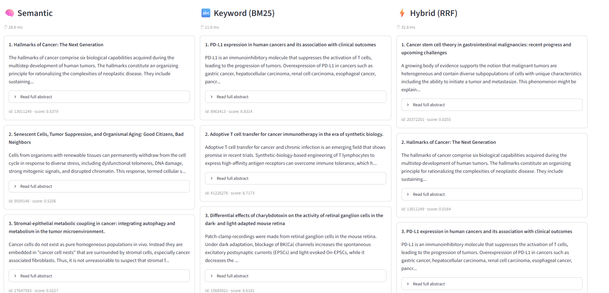
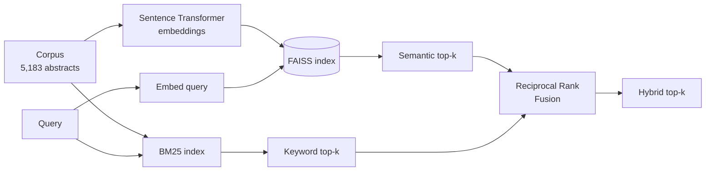

# 🔎 Semantic Search Engine

A search engine that retrieves scientific abstracts by **meaning**, not just matching words. It compares three retrieval strategies side by side and measures them with standard information-retrieval metrics.

| Method | How it works |
|---|---|
| 🧠 **Semantic** | Sentence-Transformer embeddings stored in a **FAISS** vector index, ranked by cosine similarity |
| 🔤 **Keyword** | Classic **BM25** lexical ranking (the baseline) |
| ⚡ **Hybrid** | BM25 + semantic rankings merged with **Reciprocal Rank Fusion (RRF)** |

**Stack:** Python · Sentence Transformers · FAISS · rank-bm25 · Streamlit

<!-- Add a screenshot: save it as docs/demo.png -->


## Features

- Side-by-side comparison of semantic, keyword and hybrid search in a Streamlit app
- Switchable embedding models: `all-MiniLM-L6-v2`, `BAAI/bge-small-en-v1.5`, `intfloat/e5-small-v2`
- Evaluation against ground-truth relevance labels (nDCG@10, MRR@10, Recall@10, P@5)
- Sample queries from the dataset, with labelled relevant documents marked ✅
- Embeddings and FAISS index cached on disk, so later runs start instantly

## How it works



1. **Embed:** each document (title + abstract) becomes a 384-dimensional vector. Vectors are L2-normalised, so inner product equals cosine similarity.
2. **Index:** vectors go into a FAISS `IndexFlatIP` (exact search), cached in `data/processed/`.
3. **Search:** the query is embedded the same way and FAISS returns the nearest documents.
4. **Fuse:** hybrid search scores each document by `Σ 1 / (60 + rank)` across the semantic and BM25 rankings. Because it uses ranks, not raw scores, the incompatible score scales (cosine vs BM25) don't matter.

## Dataset

[**SciFact**](https://github.com/allenai/scifact) from the [BEIR benchmark](https://github.com/beir-cellar/beir): 5,183 scientific abstracts, with scientific claims as queries and expert relevance labels (qrels). It is available on Hugging Face (`BeIR/scifact` and `BeIR/scifact-qrels`).

Expected layout:

```
data/raw/
├── corpus/corpus.jsonl
├── queries/queries.jsonl
└── qrels/qrels.json
```

The loader accepts common key names and qrels formats. Run `python inspect_data.py` to check your files load correctly.

## Results

Evaluated on 300 SciFact queries with the qrels as ground truth:

| Method | nDCG@10 | MRR@10 | Recall@10 | P@5 |
|---|---|---|---|---|
| BM25 | 0.647 | 0.607 | 0.795 | 0.148 |
| Semantic (all-MiniLM-L6-v2) | 0.641 | 0.607 | 0.769 | 0.158 |
| Hybrid (all-MiniLM-L6-v2) | 0.674 | 0.632 | 0.820 | 0.167 |
| **Semantic (bge-small-en-v1.5)** | **0.746** | **0.710** | **0.876** | **0.183** |
| Hybrid (bge-small-en-v1.5) | 0.735 | 0.700 | 0.866 | 0.178 |
| Semantic (e5-small-v2) | 0.723 | 0.693 | 0.835 | 0.175 |
| Hybrid (e5-small-v2) | 0.725 | 0.689 | 0.850 | 0.173 |

**Takeaways**

- **The embedding model matters most.** BGE improves nDCG@10 by about 10 points over BM25 and over MiniLM. E5 sits in between.
- **Hybrid helps weaker models.** With MiniLM, fusing in BM25 adds about 3 points of nDCG@10. With E5 it makes no difference, and with BGE it is slightly worse, since equal-weight fusion mixes in BM25's weaker rankings.
- **MiniLM is on par with BM25** on this term-heavy scientific dataset.
- P@5 looks low because most SciFact queries have only about one relevant document, which caps P@5 near 0.2.
- Differences of one or two points are within noise on 300 queries; the BGE gap is not.

## Example behaviour

| Query | What happens |
|---|---|
| *A cancer-related query* | Semantic stays on topic; BM25 finds precise hits (PD-L1, T-cell therapy) but also an unrelated retina paper that shares generic words; hybrid filters out the noisy result |
| `difference between ML and DL` | All methods fail. The corpus is biomedical, where "ml" and "dl" mean millilitre and decilitre. See limitations |

<!-- Add more screenshots in docs/ and reference them here -->

## Limitations

- **Domain-bound.** The corpus is biomedical abstracts, so machine-learning questions return nonsense. BM25 matches units like *ml* and *dl*, and the embedding model maps "ML" to unrelated medical terms.
- **Ambiguous abbreviations** (e.g. "MS") are resolved by the corpus, not by intent.
- **Negation is ignored** by both methods ("drugs that do not cause weight gain").
- **Exact search** (`IndexFlatIP`) is fine for ~5k documents; larger corpora would need an approximate index such as HNSW or IVF.
- General-purpose embedding models are not tuned for scientific text.

## Quick start

```bash
git clone https://github.com/<your-username>/<repo-name>.git
cd <repo-name>

python -m venv venv
source venv/bin/activate          # Windows: venv\Scripts\activate
pip install -r requirements.txt

# Place the dataset in data/raw/ as shown above, then:
python inspect_data.py            # verify the data loads
streamlit run app.py              # launch the app
```

The first run downloads the embedding model and builds the FAISS index (a few minutes on CPU). The index is then cached.

### Evaluate

```bash
python evaluate.py
python evaluate.py --max-queries 300 --models all-MiniLM-L6-v2 BAAI/bge-small-en-v1.5 intfloat/e5-small-v2
```

Results are printed and saved to `data/processed/eval_results.json`.

### Large corpora

```bash
MAX_DOCS=20000 streamlit run app.py     # Windows (PowerShell): $env:MAX_DOCS=20000; streamlit run app.py
```

Documents referenced in the qrels are always kept so evaluation stays valid.

## Project structure

```
.
├── app.py              # Streamlit UI: three-way comparison
├── search_engine.py    # Data loading, SemanticSearch, KeywordSearch, HybridSearch
├── evaluate.py         # nDCG / MRR / Recall / P@5 evaluation
├── inspect_data.py     # Dataset sanity check
├── requirements.txt
└── data/
    ├── raw/            # SciFact files (not tracked)
    └── processed/      # cached FAISS indexes (not tracked), eval_results.json
```

## Possible extensions

- Cross-encoder re-ranking of the top hybrid results
- Approximate indexes (HNSW / IVF) and larger BEIR datasets
- Fine-tuning the embedding model on domain data
- Query expansion for abbreviations
- A second corpus (e.g. ML/AI articles) with a dataset switcher in the app

## Acknowledgements

- [SciFact](https://github.com/allenai/scifact) and the [BEIR benchmark](https://github.com/beir-cellar/beir)
- [Sentence Transformers](https://www.sbert.net/), [FAISS](https://github.com/facebookresearch/faiss), [rank-bm25](https://github.com/dorianbrown/rank_bm25), [Streamlit](https://streamlit.io/)